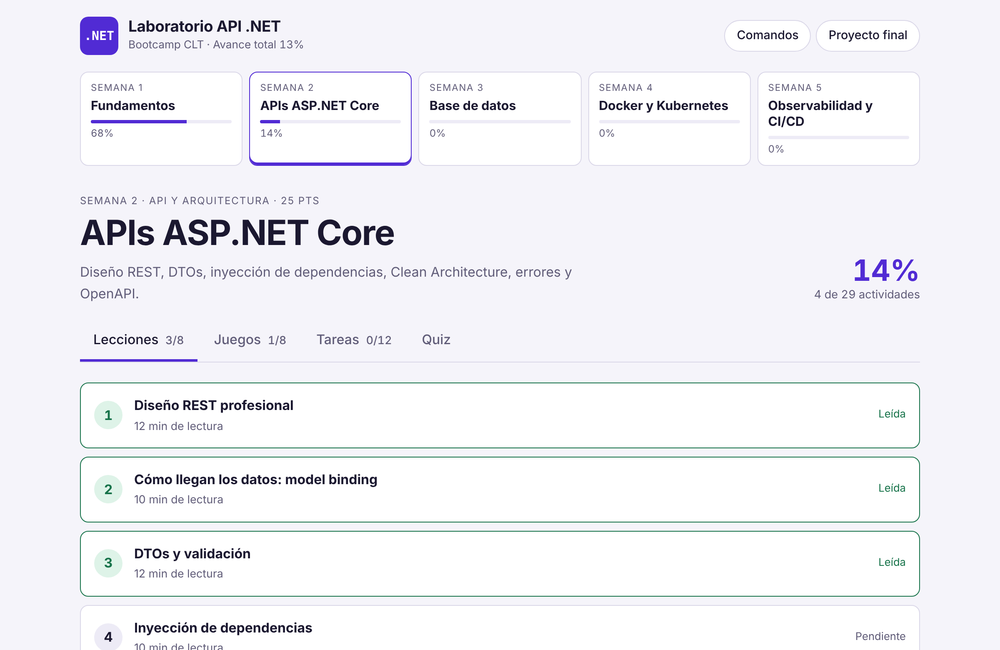
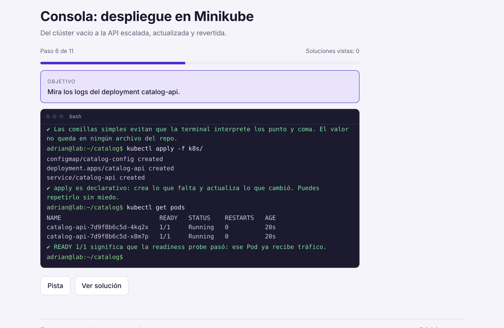
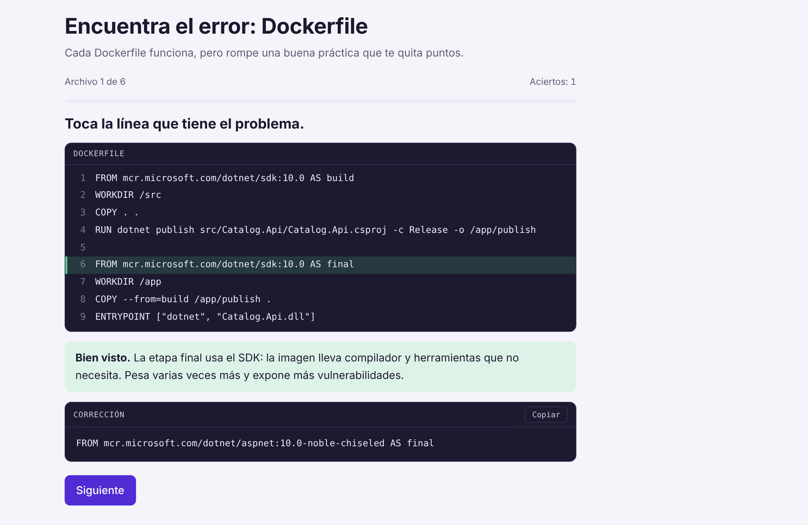
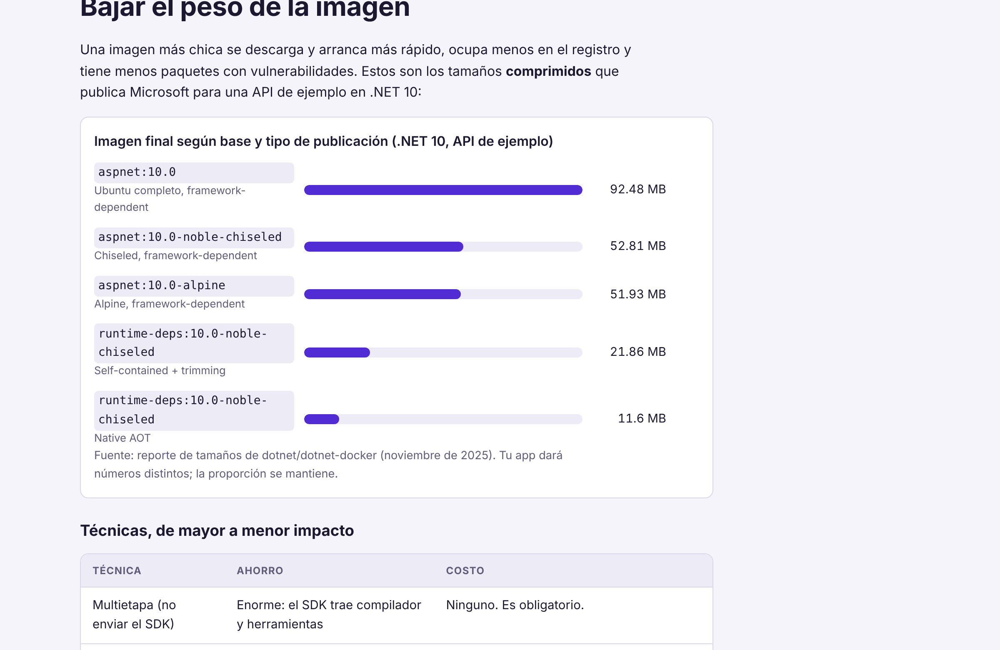
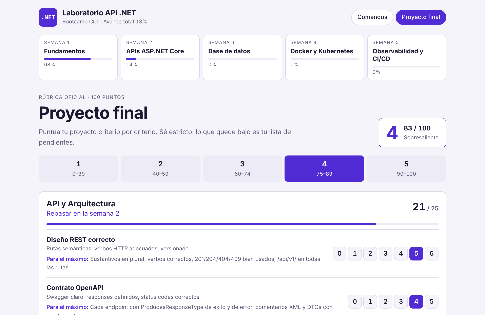

# Laboratorio API .NET

App para estudiar el **Bootcamp de APIs .NET Core** (CLT) jugando: lecciones cortas, consolas donde escribes comandos reales, juegos para fijar conceptos y una autoevaluación con la rúbrica del proyecto final.



## Qué tiene

| Semana | Tema |
|---|---|
| 1 | Fundamentos: REST, HTTP y tu primera API |
| 2 | ASP.NET Core: DTOs, DI, Clean Architecture, errores y OpenAPI |
| 3 | Base de datos: EF Core y PostgreSQL |
| 4 | Docker, Compose, Kubernetes y Helm |
| 5 | Serilog, Seq, GitHub Actions y versionado |

Cada semana trae **lecciones**, **juegos**, **tareas** para tu proyecto y un **quiz**. El avance se guarda en el navegador.

## Así se ve

**Consola:** escribes el comando real y te dice qué te falta.



**Encuentra el error:** tocas la línea que rompe una buena práctica.



**Lecciones con ejemplos y datos reales.**



**Proyecto final:** puntúa cada criterio de la rúbrica y mira tu nota.



## Cómo usarla

```bash
npm install
npm run dev
```

Abre <http://localhost:5173>.

## Agregar contenido

Todo el contenido está en `src/data/weekN/`:

```
lessons.js   lecciones
games.js     juegos (consola, opción múltiple, unir, ordenar, completar, clasificar...)
tasks.js     tareas prácticas
quiz.js      quiz de la semana
```

Edita esos archivos y la app se actualiza sola. No hace falta tocar los componentes.

---

Hecho con React y Vite.
